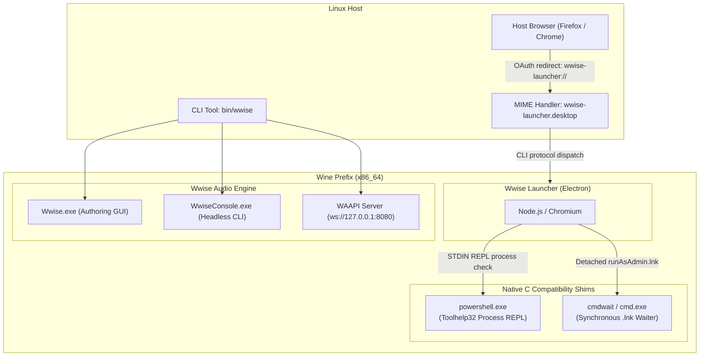

# Wwise on Linux

[](LICENSE)
[]()
[]()
[]()

> **Turnkey, production-ready environment and toolchain to run Audiokinetic Wwise, Wwise Launcher, Authoring GUI, and headless WwiseConsole natively on Linux.**

---

## Overview

Audiokinetic Wwise is the industry standard for interactive game audio, but lacks a native Linux authoring build. Historically, running Wwise on Linux via Wine has been fraught with catastrophic failures:
- Electron crashes due to Wine's missing PowerShell process enumeration.
- Authentication failures caused by symbol-forwarding collisions between `urlmon.dll` and `iertutil.dll`.
- Installation errors resulting from detached asynchronous execution of elevated `.lnk` shortcuts.
- Broken OAuth login redirects between the Linux host web browser and Wine.

**Wwise on Linux** provides engineered, native C compatibility shims, protocol routing, and automation scripts that eliminate every barrier, delivering a rock-solid, fully functioning Wwise environment ready for any task.

---

## Key Features

- **Full GUI Authoring**: Run the complete Wwise Authoring GUI with hardware acceleration, responsive UI, and low-latency audio via PulseAudio/PipeWire.
- **Audiokinetic Launcher Integration**: Install, update, and manage Wwise versions, SDK packages, and third-party plugins directly inside Linux.
- **Flawless OAuth SSO Login**: Host-to-Wine custom URI handler forwards `wwise-launcher://` redirects seamlessly from your Linux browser back to the Launcher.
- **Headless CLI (`WwiseConsole.exe`)**: Full support for headless SoundBank generation, project migration, and external audio conversion.
- **Batch Audio Conversion**: Built-in helper to convert `.wav` files into optimized game-ready `.wem` files (Vorbis High Quality, ADPCM, Opus, PCM) via `.wsources`.
- **Wwise Authoring API (WAAPI)**: Full WAAPI WebSocket & HTTP server support for Python, Node.js, and game engine pipeline automation without bridging or proxies.
- **Drop-in C Compatibility Shims**: Lightweight Win32 PE64 binaries replacing incomplete Wine subsystems.

---

## Architecture: Why Wwise on Wine Breaks & How We Fix It



### 1. `urlmon.dll` vs `iertutil.dll` Export Forwarding
- **The Problem**: Wine's builtin `urlmon.dll` forwards `CreateUri` **by name** to `iertutil.CreateUri`. Microsoft's Windows 7 `iertutil.dll` (installed by winetricks `wininet`) **exports by ordinal only** with no symbol names. Under native `iertutil`, every `CreateUri` call aborts with error 127 (`ERROR_PROC_NOT_FOUND`), crashing `vcrun2022` and breaking browser links.
- **The Fix**: The Wine prefix maintains global builtin overrides for `iertutil` and `wininet`. The installer runner scopes native network overrides only to processes that strictly require them.

### 2. Electron Process Query REPL (`powershell_shim.c`)
- **The Problem**: Audiokinetic Launcher's Electron core calls the npm package `systeminformation`, which queries running processes using PowerShell over a persistent STDIN REPL (`-Command -`). Wine's builtin `powershell.exe` exits immediately with code 0 without output, triggering `Failed to retrieve running processes (system:process.failedToRetrieveProcess)` and halting the app.
- **The Fix**: A custom C Win32 binary implements PowerShell's STDIN REPL protocol, responds to `--###START###--` and `--###ENDCMD###--` framing, queries the Win32 process snapshot via `CreateToolhelp32Snapshot`, and returns formatted process lists.

### 3. Elevated Shortcut Race Condition (`cmdwait.c`)
- **The Problem**: The Launcher installs components by creating a `runAsAdmin.lnk` shortcut and executing it via `cmd.exe`. In Wine, `shell32` executes `.lnk` targets detached/asynchronously. The parent process reads `%TEMP%\WwiseLauncher\stdout.txt` before the child writes to it, throws an error, and aborts. Moreover, Node's `child_process.exec` checks the shell name; if named anything other than `cmd.exe`, it passes `-c`, hanging Wine's `cmd` indefinitely.
- **The Fix**: `cmdwait.c` is compiled under the filename `cmd.exe` in `C:\windows\cmdwait\cmd.exe` and registered as `ComSpec`. When executing `.lnk` files, it invokes the real `system32\cmd.exe` and polls `stdout.txt` until file write operations finish.

### 4. Browser OAuth Single Sign-On Callback
- **The Problem**: Authentication redirects to `wwise-launcher://callback?code=...` in your Linux web browser. The Linux host cannot read the Wine registry to resolve Windows URL schemes.
- **The Fix**: A FreeDesktop MIME scheme handler registers `wwise-launcher://`, `ak-launcher://`, and `ak-bug-reporter://` on the host, passing the callback token directly to the running Launcher window.

---

## Prerequisites

Before starting, ensure your Linux system has:
- **Wine** (Staging 9.0+, 10.x, or 11.x recommended, 64-bit)
- **winetricks**
- **MinGW-w64** (optional, prebuilt shim binaries are included)
- **xdg-utils** (for desktop scheme registration)

#### Package Installation:

**Ubuntu / Debian / Pop!_OS:**
```bash
sudo apt update
sudo apt install wine wine64 winetricks mingw-w64 xdg-utils
```

**Arch Linux / Manjaro:**
```bash
sudo pacman -S wine wine-gecko wine-mono winetricks mingw-w64-gcc xdg-utils
```

**Fedora:**
```bash
sudo dnf install wine winetricks mingw64-gcc xdg-utils
```

---

## Quick Start & Installation

Clone the repository:
```bash
git clone https://github.com/0xra0/wwise-linux.git
cd wwise-linux
```

Run the automated setup script:
```bash
./scripts/setup.sh
```

The setup script will:
1. Initialize an isolated 64-bit Wine prefix.
2. Install required dependencies (`winhttp`, `wininet`, `xaudio29`, `vcrun2022`, `dotnet48`).
3. Apply the critical `iertutil`/`wininet` DLL override fixes.
4. Compile and install `powershell.exe` and `cmdwait` shims.
5. Register host desktop files and `wwise-launcher://` MIME scheme handlers.

---

## How to Use

### 1. Install & Sign In to Wwise Launcher
1. Download the Windows **Audiokinetic Launcher** from [audiokinetic.com/download](https://www.audiokinetic.com/en/download).
2. Run the installer:
   ```bash
   ./bin/wwise install-launcher ~/Downloads/AudiokineticLauncher-xxxx.exe
   ```
3. Complete the installation wizard.
4. Launch the installed Launcher:
   ```bash
   ./bin/wwise launcher
   ```
5. Click **Sign In**. Your default Linux browser will open the Audiokinetic login page. Complete authentication; the browser will redirect back to the Launcher and sign you in automatically!

---

### 2. Install Wwise Authoring & SDKs
Inside Wwise Launcher:
- Navigate to the **Wwise** tab.
- Click **Install a New Version** (e.g. `2023.1.14` or `2024.1`).
- Select your target deployment platforms (Windows, Linux, Android, etc.) and SDK packages.
- Complete the installation (the `cmdwait` shim ensures prerequisites install cleanly without UAC errors).

---

### 3. Launching Wwise Authoring GUI
Launch Wwise directly:
```bash
# Launch without project
./bin/wwise gui

# Launch with a specific project
./bin/wwise gui /path/to/MyGameProject.wproj
```

---

### 4. Headless WwiseConsole CLI
Run automated headless operations without launching a GUI:
```bash
# Display all WwiseConsole commands
./bin/wwise console --help

# Generate SoundBanks for your project
./bin/wwise soundbank /path/to/MyGameProject.wproj

# Run project migration
./bin/wwise console migrate "Z:\\path\\to\\Project.wproj"
```

---

### 5. Batch Audio Conversion (`.wav` to `.wem`)
Convert external audio files to Wwise's optimized `.wem` format using `.wsources` definitions:

```bash
# Convert using a .wsources list
./bin/wwise convert examples/external_sources/sample.wsources

# Or convert a single WAV directly with automatic .wsources generation
./scripts/convert-audio.sh sound.wav output/dir/
```

Example `sample.wsources`:
```xml
<?xml version="1.0" encoding="UTF-8"?>
<ExternalSourcesList SchemaVersion="1" Root="Z:\path\to\audio">
  <Source Path="sfx.wav" Conversion="Vorbis Quality High" Destination="sfx.wem"/>
</ExternalSourcesList>
```

---

### 6. Wwise Authoring API (WAAPI) Automation
Start Wwise with the WAAPI WebSocket server active:
```bash
# Start headless WAAPI server
./bin/wwise waapi /path/to/MyGameProject.wproj
```

Connect using any WebSocket or WAAPI client:
```python
from waapi import WaapiClient

with WaapiClient(url="ws://127.0.0.1:8080/waapi") as client:
    info = client.call("ak.wwise.core.getInfo")
    print("Connected to Wwise:", info["version"]["displayName"])
```

---

## CLI Reference (`bin/wwise`)

| Command | Description |
|---|---|
| `wwise launcher` | Starts the installed Audiokinetic Launcher |
| `wwise install-launcher <exe>` | Executes the Launcher installer with scoped native network overrides |
| `wwise gui [project.wproj]` | Starts Wwise Authoring graphical user interface |
| `wwise console <args...>` | Runs headless `WwiseConsole.exe` |
| `wwise convert <sources.xml>` | Converts audio files defined in `.wsources` to `.wem` |
| `wwise soundbank <project>` | Generates project SoundBanks |
| `wwise waapi [project.wproj]` | Starts the headless WAAPI server |
| `wwise url <url>` | Dispatches incoming `wwise-launcher://` URLs to running Launcher |
| `wwise test-uri` | Runs diagnostic verification of `urlmon`/`iertutil` resolution |
| `wwise status` | Displays status of prefix, Wwise installations, and shims |

---

## Repository Structure

```
├── bin/
│   ├── wwise                 # Master CLI tool
│   ├── wwise-console         # Headless WwiseConsole wrapper
│   ├── wwise-launcher        # Wwise Launcher runner
│   └── wwise-url-handler     # Desktop OAuth scheme handler
├── desktop/
│   ├── wwise-authoring.desktop # Application launcher for Authoring
│   └── wwise-launcher.desktop  # Application launcher & MIME scheme registration
├── docs/
│   ├── ARCHITECTURE.md       # In-depth technical analysis and shim design
│   └── TROUBLESHOOTING.md    # Common pitfalls and diagnostic guide
├── examples/
│   ├── external_sources/     # Batch audio conversion configuration
│   └── waapi/                # Python WAAPI client automation example
├── scripts/
│   ├── setup.sh              # Unified one-command installer
│   ├── setup-desktop.sh      # XDG desktop & MIME registration
│   ├── setup-prefix.sh       # Isolated prefix provisioning
│   ├── setup-shims.sh        # Shims compilation and deployment
│   └── convert-audio.sh      # Quick CLI audio converter
├── shims/
│   ├── Makefile              # MinGW Makefile for shims
│   ├── powershell_shim.c     # Win32 Process Snapshot REPL replacement
│   ├── cmdwait.c             # ComSpec .lnk synchronous completion wrapper
│   ├── uritest.c             # Diagnostic tool for CreateUri resolution
│   └── prebuilt/             # Prebuilt x86_64 PE binaries
├── LICENSE                   # MIT License
└── README.md
```

---

## Diagnostics & Verification

Run the built-in diagnostic suite:
```bash
# Check overall environment status
./bin/wwise status

# Verify CreateUri resolution against Wine loader
./bin/wwise test-uri
```

---

## Contributing

Contributions, issues, and feature requests are welcome! Feel free to check the [issues page](https://github.com/0xra0/wwise-linux/issues).

---

## License

This project is licensed under the [MIT License](LICENSE).
Wwise is a registered trademark of Audiokinetic Inc. This project is an independent community effort not affiliated with or endorsed by Audiokinetic.
